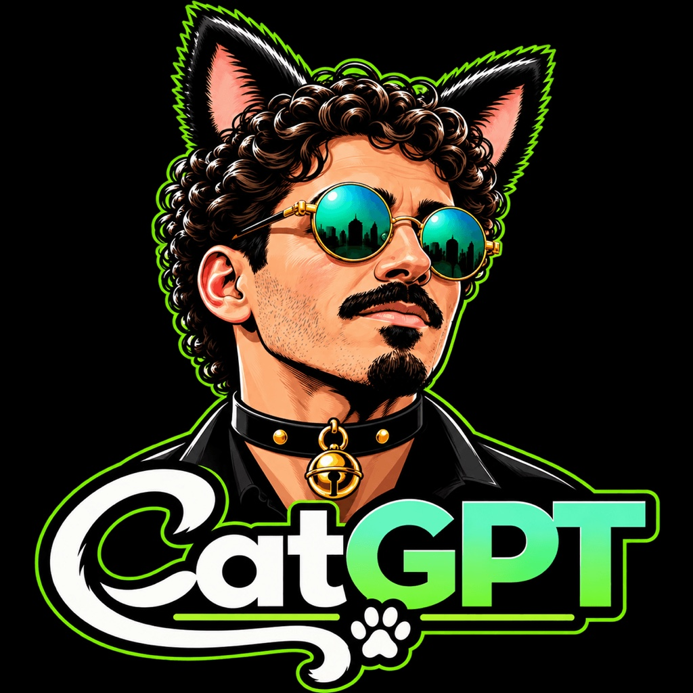
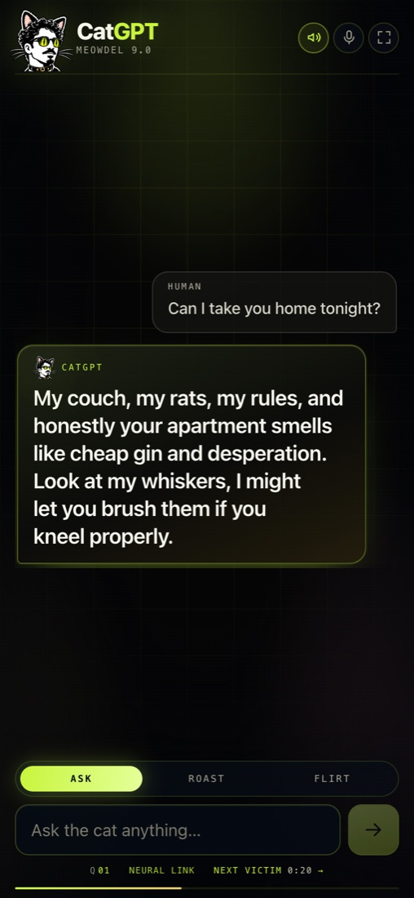
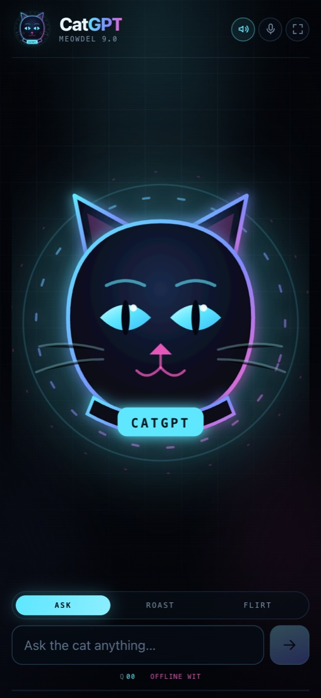
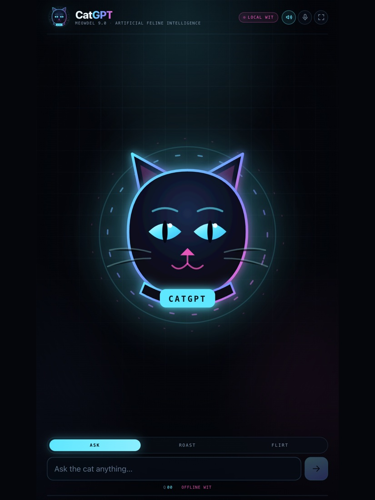

# CatGPT — Artificial Feline Intelligence

<p align="center">
  
</p>

A wearable, party-ready AI cat with opinions. Guests type a question into the screen on your
chest; CatGPT answers in one or two sentences of deadpan, flirtatious, deeply cat-shaped
judgement. Then the screen clears itself for the next victim.



This is the complete, working product — front end, secure backend, AI provider layer, offline
comedy engine, rate limits, kiosk protections, app icons, tests, and deployment instructions.
You do not need to know how to code to run it.

---

## What you actually get

| Feature | What it does |
| --- | --- |
| **Three distinct cats** | `Ask` is the Oracle: deadpan verdicts. `Roast` is the Gremlin: one sharp cut. `Flirt` is the Lap Cat: tactile, needy, push-pull. Each mode has its own moods, vocabulary, and rhythm. |
| **Real AI, any provider** | OpenAI, Anthropic Claude, Google Gemini, Groq, OpenRouter, or a local Ollama server. Switch with one env var. |
| **Works with zero internet** | A hand-written comedy engine with ~20 topics × 8 moods × 3 modes answers instantly with no API key, no Wi-Fi, and no cost. If the network dies mid-party, the browser answers locally. |
| **Offline shell** | A service worker caches the app after the first load, so even a reload works without signal. |
| **No preset questions** | Guests type whatever they want. The interface is just the cat, the input, and three moods. |
| **Fresh every time** | Each request rolls a mood, recent answers are excluded, and live models get repetition penalties. The offline engine alone produced 12/12 unique replies to the same question in testing. |
| **Party-proof UI** | Illustrated cat-man mascot, "Purrcessing…" state, huge readable answers, guest counter, auto-reset countdown. |
| **Kiosk behaviour** | Screen wake lock, optional fullscreen, zoom/long-press disabled, safe-area aware, Add-to-Home-Screen install. |
| **Sound + voice** | Tiny synthesized meows (no audio files) and optional spoken answers. Mutable. |
| **Safe by construction** | API key only on the server, per-guest and global rate limits, input caps, provider timeouts, in-character failure messages. |
| **Tested** | 53 unit tests covering the brain, moods, prompts, providers, validation, and rate limiting. |



---

## 1. Run it locally (2 minutes)

Requirements: **Node.js 20.9 or newer** (22 LTS is ideal) and npm.

```bash
cd /Users/aaronblack/Desktop/CatGPT
npm install
npm run dev
```

Open **http://localhost:3000** in your browser.

That is a fully working CatGPT. With no API key configured it uses the built-in offline comedy
engine, so you can test the entire costume experience before spending a cent.

To see which brain is active:

```bash
curl http://localhost:3000/api/health
```

```json
{
  "ok": true,
  "brain": {
    "provider": "offline",
    "model": "offline-comedy-engine",
    "ready": true,
    "note": "No API key found. Using the built-in offline comedy engine."
  }
}
```

### Useful commands

| Command | Purpose |
| --- | --- |
| `npm run dev` | Hot-reloading development server on port 3000. |
| `npm run build` | Production build (run this before deploying). |
| `npm start` | Serve the production build. |
| `npm test` | Run the 53 unit tests. |
| `npm run typecheck` | TypeScript check with no output on success. |
| `npm run check` | Typecheck + tests + production build in one go. |

---

## 2. Give it a real AI brain

The offline engine is genuinely funny, but a live model improvises better. Pick **one** provider.

| Provider | Env var | Default model | Good for |
| --- | --- | --- | --- |
| OpenAI | `OPENAI_API_KEY` | `gpt-4o-mini` | Easiest all-rounder; short, snappy jokes. |
| Anthropic | `ANTHROPIC_API_KEY` | `claude-haiku-4-5` | Dry, characterful writing. |
| Google Gemini | `GOOGLE_GENERATIVE_AI_API_KEY` | `gemini-3.5-flash` | Stable (~4s), with automatic fallback to `gemini-3.1-flash-lite`. Free tier is only **20 requests/day per model** — enable billing for a party. |
| Groq | `GROQ_API_KEY` | `llama-3.3-70b-versatile` | Very low latency. |
| OpenRouter | `OPENROUTER_API_KEY` | `google/gemini-3.5-flash-lite` | One key for many models. |
| Ollama | `OLLAMA_BASE_URL` | `llama3.2` | Runs on a laptop in your bag; no cloud bill. |

### Steps

1. Create an account on the provider's developer platform and generate an API key.
   This is **separate** from a ChatGPT Plus subscription.
2. In the provider dashboard, set a **spending limit** or hard budget. Do this before the party.
3. Copy the env template:

   ```bash
   cp .env.example .env.local
   ```

4. Open `.env.local` and fill in one key. For example:

   ```bash
   CATGPT_PROVIDER=auto
   OPENAI_API_KEY=sk-your-real-key
   OPENAI_MODEL=gpt-4o-mini
   ```

   Leave `CATGPT_PROVIDER=auto` to let CatGPT pick the first provider that has a key, then fall
   back to offline. Or pin one explicitly: `CATGPT_PROVIDER=anthropic`.

5. Restart `npm run dev` and check `/api/health`. It should no longer report `offline`. Live chat
   responses will then include `"source": "ai"` and the provider name.

```bash
curl -X POST http://localhost:3000/api/chat \
  -H 'Content-Type: application/json' \
  -d '{"question":"Are you single?","mode":"flirt"}'
```

```json
{
  "reply": "I'm emotionally unavailable, but I will sleep in your bed and judge your choices.",
  "source": "ai",
  "mode": "flirt",
  "provider": "openai",
  "remaining": 11
}
```

> **Never** put an API key in `NEXT_PUBLIC_*`, in client code, or in a public repo. This app only
> reads keys on the server. If you ever leak one, revoke it in the provider dashboard immediately.

### Making it cheaper

- Keep answers short: `CATGPT_MAX_ANSWER_CHARS=220` (already the default) and output tokens are
  capped at 160 on the server.
- Set `CATGPT_GLOBAL_LIMIT` to the maximum number of questions per minute you are willing to pay for.
- Use `gpt-4o-mini`, `gemini-3.5-flash`, `claude-haiku-4-5`, or Groq's free/cheap tier.

> **Gemini model tip:** `gemini-3.5-flash` is the current default, with `gemini-3.1-flash-lite` as an
> automatic fallback. The older `gemini-3.5-flash-lite` ID is remapped because Google is returning
> sustained 503s and 20s+ stalls for it. Full “thinking” models need a larger token budget, or they
> eat the output before they write the joke.

> **Free-tier reality check:** Google's Gemini free tier allows only **20 requests per day per
> model**. A party burns through that in minutes; Google then returns `429 RESOURCE_EXHAUSTED`
> with a retry time measured in hours. CatGPT correctly falls back to `OFFLINE WIT`. For a real
> party, either enable billing on the Google key or switch to Groq:
>
> ```bash
> CATGPT_PROVIDER=groq
> GROQ_API_KEY=gsk_...
> GROQ_MODEL=llama-3.3-70b-versatile
> ```
>
> Groq's free tier is much more generous (roughly 30 requests/minute), and CatGPT already supports
> it. The provider status pill will say `NEURAL LINK` when the model answers.
- For a single evening, actual usage is usually a few dollars at most. Prices change — check your
  provider's current pricing page. This project makes no billing guarantees.

---

## 3. Put it on the internet (Vercel, ~5 minutes)

Your phone needs a URL to load the app from. Vercel's free tier is plenty for one costume.

### Option A — GitHub + Vercel dashboard

```bash
cd /Users/aaronblack/Desktop/CatGPT
git init
git add .
git commit -m "CatGPT: wearable artificial feline intelligence"
```

1. Create an empty repository on GitHub (private is fine).
2. Copy the two commands GitHub shows under "push an existing repository", e.g.:

   ```bash
   git remote add origin https://github.com/YOUR_NAME/catgpt.git
   git branch -M main
   git push -u origin main
   ```

3. Go to **vercel.com/new**, import the repo. Next.js is detected automatically.
4. Before clicking Deploy, open **Environment Variables** and add:
   - `CATGPT_PROVIDER` = `auto`
   - `OPENAI_API_KEY` = your key (or whichever provider you chose)
5. Deploy. Open `https://your-project.vercel.app/api/health` and confirm the provider.
6. Open the root URL on your phone.

### Option B — Vercel CLI

```bash
npm i -g vercel
vercel login
vercel            # follow prompts, accept the detected Next.js defaults
vercel env add OPENAI_API_KEY production
vercel --prod
```

### Important production notes

- **Secrets:** environment variables live in Vercel's dashboard. They are never bundled into the
  browser. Redeploy after changing them.
- **Rate limiting is per server instance.** The built-in limiter is an in-memory sliding window,
  which is perfect for a party but is not a global defence across many serverless instances. The
  real spend protection is the hard budget you set in your AI provider's dashboard.
- **Scaling up:** for a public event, swap the two limiters in `app/api/chat/route.ts` for a shared
  store (Upstash Redis works well). The limiter interface is small and injectable.
- **Privacy:** the app stores no conversations. Guest questions and answers exist only in memory
  for the current screen. The only third party that sees a question is your chosen AI provider.
- **robots:** indexing is disabled in the metadata, but a public URL can still be found. Keep the
  deployment URL private-ish, or add Vercel password protection if your plan supports it.

---

## 4. Put it on the phone (and lock it down)

### iPhone / iPad

1. Open your deployed URL in **Safari**.
2. Tap **Share → Add to Home Screen → Add**.
3. Launch CatGPT from the new icon. It runs full-screen without Safari's toolbars.

**Guided Access** keeps guests inside the app:

1. **Settings → Accessibility → Guided Access → On**, set a passcode.
2. Open CatGPT, then **triple-click the side button**.
3. Tap **Start** (top right). To leave: triple-click again and enter the passcode.

Before the party, also:

- **Settings → Display & Brightness → Auto-Lock → Never**
- Turn **Low Power Mode off** (it can block the screen wake lock)
- Brightness to maximum; turn off True Tone/Night Shift if you want the neon colours pure
- Turn on **Do Not Disturb** so notifications don't cover the cat
- If using a hotspot, plug the phone in — hotspot + full brightness drains fast

### Android

1. Open the URL in Chrome → **⋮ → Add to Home screen**.
2. Enable **Screen pinning** (Settings → Security) or use Fully Kiosk Browser for a stricter kiosk.
3. Keep the screen awake with the app's built-in wake lock; make sure battery saver is off.

### A note on screen size

The layout is portrait-first and works from **320 px wide** up. A phone at 390–430 px is the
sweet spot: light enough to wear, big enough for a guest to type on. Tablets work too — the app
centres itself at a 620 px max width so the line length stays readable.



---

## 5. Party controls

| Control | What it does |
| --- | --- |
| **Ask / Roast / Flirt** | Switches between the Oracle, the Gremlin, and the Lap Cat. Each has its own voice and moods. |
| **Send** | Submits the question. Enter works too. |
| **Sound icon** | Mutes/unmutes the synthesized chirps. Preference is remembered. |
| **Mic icon** | Speaks the answer out loud (device voice). Off by default — parties are loud. |
| **Fullscreen icon** | Browser fullscreen where supported (desktop/Android; iOS uses Guided Access). |
| **Next victim →** | Clears the screen immediately and starts fresh. |
| **Auto-reset** | After an answer, a countdown clears the screen. Pauses while someone is typing. |
| **Q counter** | Question tally for the night, stored in the browser session. Resets when the tab closes. |
| **Status pill** | `NEURAL LINK` = live model, `OFFLINE WIT` = local comedy engine. |

### Configuration

Copy `.env.example` to `.env.local` (local) or add these in Vercel (production):

| Variable | Default | Meaning |
| --- | --- | --- |
| `CATGPT_PROVIDER` | `auto` | `auto`, `openai`, `anthropic`, `google`, `groq`, `openrouter`, `ollama`, or `offline`. |
| `OPENAI_API_KEY` and friends | — | Provider credentials. Server-side only. |
| `OPENAI_MODEL` and friends | see table | Override the model per provider. |
| `CATGPT_MAX_ANSWER_CHARS` | `220` | Hard cap on answer length, clamped 80–400. |
| `CATGPT_RATE_LIMIT` | `12` | Questions per guest IP per window. |
| `CATGPT_RATE_WINDOW_SECONDS` | `60` | Window length, clamped 5–3600. |
| `CATGPT_GLOBAL_LIMIT` | `120` | All guests combined, per minute. Your wallet's seatbelt. |
| `NEXT_PUBLIC_RESET_SECONDS` | `30` | Seconds before the screen auto-clears. Clamped 10–300. |

Changing `NEXT_PUBLIC_*` requires a rebuild/redeploy, because the value is compiled into the app.

---

## 6. How it works

```text
┌─────────────────────────────┐
│  Phone / tablet (browser)   │
│  • animated CatGPT UI       │
│  • modes, reset, sounds     │
│  • local fallback jokes     │
└──────────────┬──────────────┘
               │ POST /api/chat  { question, mode, avoid[] }
               ▼
┌─────────────────────────────┐
│  Next.js server route       │
│  1. sanitize + cap input    │
│  2. per-guest rate limit    │
│  3. global spend limit      │
│  4. roll a cat mood         │
│  5. build the persona       │
└──────────────┬──────────────┘
               │
      ┌────────┴─────────┐
      ▼                  ▼
┌──────────────┐   ┌─────────────────────┐
│ AI provider  │   │ Offline comedy brain│
│ (optional)   │   │ always available    │
└──────┬───────┘   └──────────┬──────────┘
       └──────────┬───────────┘
                  ▼
      { reply, source, mode, provider, remaining }
```

Why the offline engine matters: a live model can time out, a hotspot can die, or you can arrive at
a basement party with no signal. In every one of those cases CatGPT still answers with a fresh joke
instead of showing an error. The client also answers locally if the request never reaches the
server at all.

### Safety rails

- The API key is read only in server code (`lib/config.ts`) and never serialized to the client.
- Guest questions are stripped of control characters and capped at 180 characters.
- Answers are capped at `CATGPT_MAX_ANSWER_CHARS` (default 220), and model output tokens are capped.
- Requests time out after 12 seconds; the guest gets an offline joke rather than an endless spinner.
- Per-guest and global sliding-window limits protect against spam and runaway spend.
- The last 24 answers are excluded from every new reply, and live models run at high temperature
  with repetition penalties, so the same question keeps getting a new answer.
- The persona forbids slurs, sexual explicitness, real medical/legal/financial advice, and cruelty.
  Roasts may target behaviour and costumes, never bodies or identities.

---

## 7. Tests

```bash
npm test          # 53 tests, about a second
npm run typecheck
npm run build
```

What is covered:

- `tests/offlineBrain.test.ts` — topic routing, mood banks, all modes, length caps, 20-answer uniqueness, determinism.
- `tests/personality.test.ts` — persona rules, prompt delimiters, reply clamping.
- `tests/providers.test.ts` — OpenAI-compatible parsing, parameter retry, Anthropic, Gemini, failures.
- `tests/config.test.ts` — provider auto-detection, explicit providers, missing keys, clamped limits.
- `tests/rateLimit.test.ts` — budgets, window reset, per-key isolation, memory pruning, proxy IPs.
- `tests/validate.test.ts` — input sanitization, length caps, mode fallback, avoid-list limits.

## 8. Troubleshooting

| Symptom | Fix |
| --- | --- |
| "CatGPT has answered enough of your questions…" | Working as intended. Raise `CATGPT_RATE_LIMIT` or wait for the window. |
| Status says `OFFLINE WIT` even though you added a key | Restart the dev server / redeploy after editing env. Check `/api/health` for the note, verify the exact variable name, and make sure `CATGPT_PROVIDER` is `auto` or matches your provider. |
| Answers take several seconds | Use a fast model: `gemini-3.5-flash` or Groq. After two 6-second attempts the server gives up and answers offline. |
| Keeps falling back to `OFFLINE WIT` | Run a live probe: `curl -s "https://cat-gpt-six.vercel.app/api/health?probe=1"`. If `probe.reason` is `quota_exhausted`, the key hit Google's **20 requests/day free-tier limit**; `probe.quotaModel` and `probe.retryAfterSeconds` show the model and reset time. `quota_cooldown` / `provider_cooldown` means CatGPT is briefly skipping a dead API so replies stay instant. `http_503` = Google busy, `timeout` = model too slow, `blocked`/`safety` = safety filter, `not_configured` = key missing. |
| Gemini says the model is "no longer available to new users" | Google retires model IDs. List what your key can use, then set `GOOGLE_MODEL` to a current one (for example `gemini-3.5-flash`). |
| Answers feel too long or get cut off | Lower `CATGPT_MAX_ANSWER_CHARS` for punchier jokes. Raising it also allows longer model output; the token cap is 160. |
| Keyboard covers the input on iPhone | iOS sometimes overlays the keyboard. The app requests resize behaviour; if it persists, the page should still scroll the field into view. Guided Access prevents accidental dismissal. |
| Screen dims or locks | Disable Low Power Mode and set Auto-Lock to Never. Wake lock needs a visible tab and a supported browser. |
| Old version after deploying | Close the home-screen app completely and reopen, or remove and re-add it. Safari caches aggressively. |
| `GET /api/chat` returns 405 | Expected — the endpoint only accepts `POST`. |
| Build fails on an old Node | Use Node 20.9+ (22 LTS recommended). |
| Fonts/colours look slightly different on Android | The UI uses system fonts by design; the neon palette is identical. |

---

## 9. Budget (planning estimates, not quotes)

| Item | Typical cost |
| --- | --- |
| Vercel hosting | $0 on the hobby tier for a personal project |
| AI API for one evening | Often a few dollars; depends on provider, model, and question count |
| Domain name (optional) | ~$10–25/year |
| Phone mount / chest rig | ~$15–60 |
| Slim power bank | ~$20–40 |
| Collar or nameplate | ~$20–60 |
| **Required to start** | **$0** — the offline engine works with no keys at all |

For hardware, mounting, battery, and a full party-night checklist, see
**[docs/COSTUME.md](docs/COSTUME.md)**.

To rewrite CatGPT's voice or add new offline topics, see
**[docs/PERSONALITY.md](docs/PERSONALITY.md)**.

---

## 10. File map

```text
app/
  api/chat/route.ts      Party endpoint: limits, validation, AI → offline fallback
  api/health/route.ts    Secret-free status: which brain is active
  globals.css            The entire neon design system
  layout.tsx             Metadata, PWA hooks, viewport/kiosk settings
  manifest.ts            Add-to-Home-Screen manifest
  page.tsx               Renders the app
components/
  CatAvatar.tsx          The illustrated mascot with its spinning halo
  CatGptApp.tsx          The kiosk UI and interaction logic
lib/
  config.ts              Provider auto-detection and env parsing
  modes.ts               Mode copy and placeholders (client-safe)
  moods.ts               Mode-scoped cat moods and selection
  offlineBrain.ts        ~20 topics × 3 modes of hand-written comedy
  personality.ts         The CatGPT system prompt and reply clamping
  providers.ts           OpenAI / Anthropic / Gemini / Groq / OpenRouter / Ollama adapters
  rateLimit.ts           Sliding-window limiter and proxy-aware client keys
  sfx.ts                 Synthesized WebAudio chirps
  types.ts               Shared request/response types
  validate.ts            Input sanitization and caps
public/                  Brand artwork, icons, offline service worker
tests/                   53 unit tests
docs/                    Costume guide, personality guide, screenshots
```

---

Built to answer the only question that matters at a Halloween party: *"is that cat judging me?"*
Yes. Constantly. Go ask it something.


